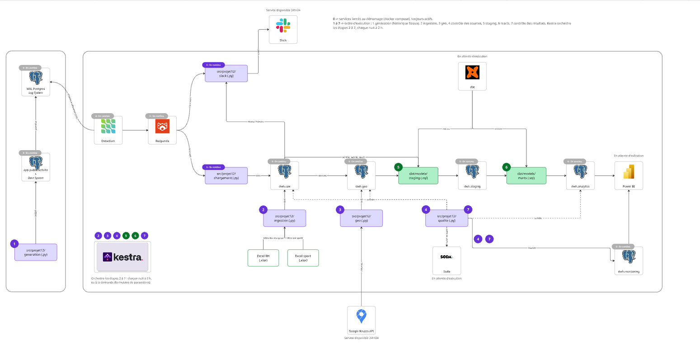

# Projet 12 — POC « Avantages sportifs » pour Sport Data Solution

Projet 12 du parcours Data Engineer d'OpenClassrooms (option B : « Créez et automatisez une
architecture de données »).

---

## Introduction

### Contexte

**Sport Data Solution** est une entreprise basée à Lattes (1362 Av. des Platanes, 34970 Lattes),
spécialisée dans les données sportives. Elle compte **161 salariés**, dont une partie pratique
une activité physique régulière, et parfois se rend au bureau à pied ou à vélo.

La direction souhaite **encourager la pratique sportive** de ses salariés avec deux avantages :

| Avantage | Règle |
|---|---|
| **Prime sportive** | **5 % du salaire brut annuel** pour les salariés qui viennent au bureau par un moyen sportif (marche/course, vélo/trottinette), à condition que le trajet soit plausible : **15 km maximum à pied, 25 km à vélo** |
| **Journées bien-être** | **5 jours** accordés aux salariés ayant pratiqué **au moins 15 activités physiques** dans l'année |

Elle souhaite aussi **créer une émulation** : chaque nouvelle activité sportive d'un salarié
doit être annoncée sur le **Slack** de l'entreprise (« Bravo Juliette ! Tu viens de courir
10,8 km en 46 min ! »).

Les données disponibles :

- un **fichier RH** (Excel) : salariés, date d'embauche, salaire brut, adresse, moyen de déplacement déclaré… ;
- un **fichier sportif** (Excel) : sport pratiqué déclaré par chaque salarié ;
- les **activités sportives**, qui proviendraient en production d'une application de type
  **Strava**. Pour le POC, elles sont **simulées** : 12 mois d'historique, puis des séances en
  temps réel.

### Mission

Réaliser un **POC (Proof of Concept)** démontrant la faisabilité technique d'un système qui :

1. collecte les données RH, sportives et les activités ;
2. vérifie les déclarations de trajet (distance domicile-bureau calculée avec l'API **Google Maps / Routes**) ;
3. calcule automatiquement les avantages et leur coût, avec des paramètres modifiables ;
4. publie un message Slack pour chaque nouvelle activité ;
5. contrôle la **qualité** des données, **supervise** le pipeline, et restitue les résultats dans **Power BI**.

---

## Partie 1 — Présentation de l'application et objectifs

### 1.1 Objectifs du POC

| Idée de la direction | Objectif du POC |
|---|---|
| Récompenser les trajets sportifs | Calculer l'éligibilité et le montant de la prime, en **vérifiant la distance** domicile-bureau de chaque déclaration |
| Récompenser la pratique régulière | Compter les activités valides sur 12 mois et attribuer les journées bien-être |
| Maîtriser le budget | Chiffrer le coût total des avantages, et pouvoir **simuler d'autres paramètres** (taux, seuils, nombre d'activités) |
| Créer une émulation | Annoncer chaque nouvelle activité sur Slack, **en temps réel** |
| Décider sur des données fiables | Contrôler la qualité des données et **bloquer les calculs** si les sources sont incorrectes |
| Piloter | Restituer coûts, éligibilités et état du pipeline dans **Power BI** |

### 1.2 Tâches réalisées par le POC

1. **Simuler** une application de type Strava (historique de 12 mois + séances en direct, avec anomalies volontaires possibles).
2. **Capter en temps réel** chaque nouvelle activité (CDC : *Change Data Capture*) et la transmettre par un bus de messages.
3. **Charger** les activités dans un entrepôt de données (*data warehouse*).
4. **Publier** un message Slack par activité cohérente, avec le nom du salarié.
5. **Ingérer** les référentiels RH et sportif.
6. **Calculer** les distances domicile-bureau avec Google Routes API (avec cache).
7. **Contrôler** la qualité des sources, puis des résultats (Soda).
8. **Transformer** les données et calculer les avantages (dbt), avec historique des simulations de paramètres.
9. **Orchestrer** le pipeline batch (Kestra) : exécution chaque nuit, ou à la demande avec d'autres paramètres, et alerte Slack en cas d'échec.
10. **Superviser** : chaque étape trace son exécution et sa volumétrie dans l'entrepôt.
11. **Restituer** les résultats dans un rapport Power BI.

### 1.3 Points d'attention

**Confidentialité des données (RGPD)**
- Les données RH (salaires, adresses) **ne sont jamais versionnées** : `data/`, `*.xlsx`, `.env` et `*.pbix` sont exclus de git et des images Docker.
- **Principe du moindre privilège** : un rôle PostgreSQL par usage (`app_writer`, `debezium`, `etl`, `powerbi_reader`, `slack_notifier`, `kestra`), chacun limité au strict nécessaire.
- Le consommateur Slack ne lit qu'une **vue de trois colonnes** (`raw.noms_salaries` : identifiant, prénom, nom), sans aucun accès aux salaires ni aux adresses.
- Les tables lues par Power BI (`analytics`) ne contiennent **aucune donnée nominative**. Le fichier `.pbix` n'est pas versionné, car le montant de la prime (5 % du salaire) permet de retrouver les salaires.
- Les **secrets** (mots de passe, clé Google, webhook Slack) sont dans un fichier `.env` local, jamais dans le code ni dans les logs.
- La télémétrie de dbt et de Soda est **désactivée**.

**Disponibilité et fiabilité**
- Les services temps réel tournent en continu et sont **relancés automatiquement** par Docker en cas d'arrêt.
- Garantie **at-least-once** : un message n'est validé qu'après traitement. Le chargement est **idempotent** (*upsert*) : un message reçu deux fois ne crée pas de doublon.
- Toutes les étapes batch sont **rejouables** à volonté.
- Le contrôle qualité des sources **bloque les calculs** en cas d'échec : aucun résultat faux n'est publié.

**Compatibilité avec les API**
- **Google Routes API** (`computeRouteMatrix`) : appels par lots, *field mask* pour limiter le coût, **cache en base** pour ne pas rappeler l'API à chaque exécution. La clé est restreinte à la seule Routes API.
- **Slack** : webhook entrant, gestion de la limite de débit (code 429, en-tête `Retry-After`) et nouvelles tentatives.
- **Activités** : format JSON produit par Debezium, proche de celui d'une API d'activités sportives.

**Ressources limitées**
- Le poste de développement (Windows + WSL2, 16 Go de RAM) impose une architecture **légère** : PostgreSQL + dbt plutôt que Spark, Redpanda plutôt que Kafka, Kestra lancé seulement quand il est utile, image des consommateurs allégée.

---

## Partie 2 — Architecture de l'application

### 2.1 Schéma de l'architecture et services associés



*Schéma réalisé avec Miro. Pastille **0** : services lancés au démarrage, toujours actifs.
Pastilles **1 à 7** : ordre d'exécution (1 = source externe simulée ; 2 à 7 = pipeline
orchestré par Kestra).*

**Services existants, utilisés tels quels**

| Service | Version | Rôle |
|---|---|---|
| PostgreSQL | 16 (alpine) | Bases `app` (source simulée), `dwh` (entrepôt) et `kestra` (base interne de Kestra) |
| Debezium Server | 3.0 | Capture des changements (CDC) dans le journal de PostgreSQL (WAL) |
| Redpanda | 24.3 | Bus de messages compatible Kafka |
| Redpanda Console | 2.8 | Interface web : topics, messages, groupes de consommateurs |
| Kestra | 1.3 | Orchestration du pipeline batch |
| dbt (dbt-postgres) | 1.12 / 1.11 | Transformations SQL et tests |
| Soda Core | 3.5 | Contrôles de qualité des données |
| Power BI Desktop | — | Rapport de restitution |
| Google Routes API | v2 | Distances domicile-bureau |
| Slack | — | Messages d'émulation et alertes |

**Composants développés**

| Composant | Langage | Rôle |
|---|---|---|
| `src/projet12/generation` | Python | Simulation de l'application Strava (historique, live, anomalies) |
| `src/projet12/ingestion` | Python | Ingestion des fichiers RH et sportif + vue des noms pour Slack |
| `src/projet12/geo` | Python | Distances domicile-bureau (Google Routes API, cache) |
| `src/projet12/qualite` | Python | Lancement des contrôles Soda et traçabilité des résultats |
| `src/projet12/chargement` | Python | Consommateur Redpanda → entrepôt (`raw.activites`) |
| `src/projet12/slack` | Python | Consommateur Redpanda → messages Slack |
| `dbt/models/staging` | SQL | Nettoyage et règles de validité (vues) |
| `dbt/models/marts` | SQL | Calcul des avantages, KPI et historique (tables) |
| `kestra/flows` | YAML | Flow d'orchestration du pipeline batch |
| `soda/checks` | YAML | 35 contrôles de qualité |
| `docker/` | Dockerfile, SQL | Images (Kestra, consommateurs) et initialisation de PostgreSQL |

### 2.2 Arborescence

```
projet12/
├── .env.example                 # modèle des variables d'environnement (secrets à renseigner)
├── .dockerignore                # ce qui n'entre jamais dans une image (secrets, données RH)
├── docker-compose.yml           # tous les services
├── pyproject.toml / uv.lock     # dépendances Python (uv)
├── data/raw/                    # fichiers Excel RH et sportif (NON versionnés)
├── docker/
│   ├── postgres/init/01_init.sh # bases, rôles, droits, schémas, publication CDC
│   ├── debezium/application.properties
│   ├── kestra/Dockerfile        # image Kestra + uv
│   └── consumers/Dockerfile     # image des consommateurs temps réel
├── src/projet12/
│   ├── config.py                # configuration commune (variables d'environnement, connexions)
│   ├── generation/              # simulation Strava : generateur.py, profils.py, ecriture.py
│   ├── ingestion/               # référentiels RH et sport : referentiels.py
│   ├── geo/                     # distances : routes.py (API), distances.py (cache, base)
│   ├── qualite/                 # contrôles Soda : controles.py
│   ├── chargement/              # consommateur → entrepôt : consommateur.py, entrepot.py
│   └── slack/                   # consommateur → Slack : consommateur.py, messages.py
├── dbt/
│   ├── dbt_project.yml / profiles.yml
│   ├── seeds/                   # parametres.csv, vitesses_max.csv
│   ├── models/staging/          # stg_activites, stg_salaries, stg_sports, stg_distances, stg_parametres
│   ├── models/marts/            # activites, avantages_salaries, kpi_synthese, historique_kpi
│   ├── tests/                   # tests métier (montant de la prime, cohérence des KPI…)
│   └── macros/                  # tracer_execution (monitoring), generate_schema_name
├── soda/
│   ├── configuration.yml        # connexions aux schémas raw, geo, analytics
│   └── checks/                  # raw.yml, geo.yml, analytics.yml
├── kestra/flows/pipeline_avantages.yml
├── tests/                       # tests unitaires (pytest)
├── notebooks/                   # exploration initiale des données
└── docs/
    ├── demo.md                  # déroulé complet de la démo
    ├── powerbi.md               # guide de construction du rapport Power BI
    └── architecture.png         # schéma d'architecture
```

| Répertoire | Contenu et traitements |
|---|---|
| `docker/` | Images Docker et script d'initialisation de PostgreSQL : création des bases `app`, `dwh` et `kestra`, des rôles et de leurs droits, des schémas de l'entrepôt et de la publication lue par Debezium. |
| `src/projet12/` | Le code Python, un sous-paquet par traitement, lancé par `python -m projet12.<module>`. `config.py` centralise la lecture du `.env` et les connexions. |
| `dbt/` | Les transformations SQL : les **seeds** (paramètres métier versionnés), le **staging** (nettoyage, règles de validité) et les **marts** (résultats lus par Power BI), avec leurs tests. |
| `soda/` | La configuration et les 35 contrôles de qualité, répartis par schéma. |
| `kestra/` | La définition du pipeline batch (tâches, paramètres, planification, alerte). |
| `tests/` | Les tests unitaires des modules Python (génération, ingestion, geo, chargement, messages Slack), sans base de données. |
| `docs/` | La documentation : démo, guide Power BI, schéma. |

**Schémas de la base `dwh`**

| Schéma | Contenu | Écrit par |
|---|---|---|
| `raw` | données brutes : `activites`, `salaries`, `sports` + vue `noms_salaries` | chargement, ingestion |
| `geo` | `distances_domicile_travail` | geo |
| `staging` | vues de nettoyage | dbt |
| `analytics` | `activites`, `avantages_salaries`, `kpi_synthese`, `historique_kpi` + seeds | dbt |
| `monitoring` | `pipeline_runs`, `qualite_checks` | toutes les étapes |

### 2.3 Environnement virtuel et dépendances

Le projet utilise **[uv](https://docs.astral.sh/uv/)** plutôt que `venv` + `pip` :

- un seul outil pour Python, l'environnement virtuel et les dépendances ;
- un fichier de verrouillage (`uv.lock`) qui garantit **les mêmes versions partout** : poste de développement, Kestra, image Docker ;
- une installation beaucoup plus rapide que pip ;
- des **groupes de dépendances** : l'image des consommateurs n'installe que le socle (12 paquets, image de 383 Mo au lieu de 2 Go).

| Dépendance | Groupe | Rôle |
|---|---|---|
| `psycopg[binary]` | socle | Connexion à PostgreSQL |
| `confluent-kafka` | socle | Client Kafka/Redpanda (consommateurs) |
| `httpx` | socle | Appels HTTP (Google Routes API, webhook Slack) |
| `python-dotenv` | socle | Lecture du fichier `.env` |
| `pandas`, `openpyxl` | batch | Lecture et validation des fichiers Excel |
| `dbt-postgres` | batch | Transformations SQL et tests |
| `soda-core-postgres` | batch | Contrôles de qualité |
| `matplotlib` | batch | Graphiques d'exploration (notebook) |
| `pytest`, `ruff` | dev | Tests unitaires, analyse statique du code |

```bash
uv sync                                   # installe socle + batch + dev (poste de développement)
uv sync --no-dev                          # socle + batch (Kestra)
uv sync --no-default-groups               # socle seul (image des consommateurs)
```

---

## Partie 3 — Applications et services

### 3.1 Services conteneurisés lancés par Docker (en continu)

**PostgreSQL** (`p12-postgres`)
- Héberge trois bases : `app` (source simulée, rôle `app_writer`), `dwh` (entrepôt, rôle `etl`), `kestra`.
- Configuré avec `wal_level=logical` : son journal de transactions (WAL) peut être lu par Debezium.
- Initialisé par `docker/postgres/init/01_init.sh` au premier démarrage : rôles, droits, schémas, publication `dbz_activites`.

**Redpanda** (`p12-redpanda`) et **Redpanda Console** (`p12-redpanda-console`)
- Bus de messages compatible Kafka, plus léger (un seul binaire, pas de JVM ni de ZooKeeper).
- Topic `app.public.activites` : une activité = un message JSON.
- Chaque groupe de consommateurs garde sa position de lecture (*offset*) : un consommateur arrêté reprend où il s'était arrêté.
- Console web sur http://localhost:8085.

**Debezium Server** (`p12-debezium`)
- Lit en continu le WAL de la base `app` (slot de réplication, plugin `pgoutput`).
- Publie chaque insertion dans Redpanda. Après un instantané initial de la table, il ne l'interroge plus : il suit le journal (pas de requêtes répétées).
- Conserve sa position dans un volume : rien n'est perdu en cas de redémarrage.

**Consommateur de chargement** (`p12-chargement`, module `projet12.chargement`)
- Groupe `dwh-loader`, lecture depuis le début du topic.
- Écrit chaque activité dans `dwh.raw.activites` (*upsert* : jamais de doublon), par lots, et trace chaque lot dans `monitoring.pipeline_runs`.

**Consommateur Slack** (`p12-slack`, module `projet12.slack`)
- Groupe `slack-notifier`, lecture des nouveaux messages uniquement.
- Ne publie que les séances **live** et **cohérentes** : dates valides, distance entre 0 et 300 km, vitesse plausible pour le sport. Les vitesses maximales sont lues dans `dbt/seeds/vitesses_max.csv`, le même fichier que dbt et Soda.
- Affiche le nom du salarié, lu dans la vue `raw.noms_salaries`. L'annuaire est relu à chaque identifiant inconnu : le consommateur peut démarrer avant l'ingestion et découvre les nouveaux salariés sans redémarrage.

**Kestra** (`p12-kestra`, lancé à la demande)
- Orchestre le pipeline batch : flow `sport_data.pipeline_avantages`.
- Exécution planifiée **chaque nuit à 2 h**, ou manuelle avec un **formulaire de paramètres** (taux, seuils, nombre d'activités, recalcul des distances).
- Alerte Slack en cas d'échec d'une tâche.
- Les tâches s'exécutent dans le conteneur Kestra (*task runner* `Process`), avec le projet monté en lecture seule et son environnement uv.
- Interface sur http://localhost:8080.

### 3.2 Services non conteneurisés, lancés par Kestra ou manuellement

| # | Composant | Traitement |
|---|---|---|
| 1 | `projet12.generation` | **Source externe simulée** (non orchestrée par Kestra). `backfill` : 12 mois d'historique (~7 900 séances) ; `live` : séances en direct, avec option `--taux-anomalies`. Écrit dans `app.public.activites` avec le rôle `app_writer`. |
| 2 | `projet12.ingestion` | Lit les deux fichiers Excel, valide leur **structure** (colonnes, identifiants vides ou en double), recharge `raw.salaries` et `raw.sports` en une transaction (un fichier invalide n'écrase jamais des données correctes), puis crée la vue `raw.noms_salaries` ouverte au seul rôle `slack_notifier`. |
| 3 | `projet12.geo` | Calcule la distance domicile-bureau des salariés au trajet sportif (Google Routes API, mode marche ou vélo). Seuls les trajets nouveaux ou modifiés sont calculés (cache). Écrit `geo.distances_domicile_travail`. |
| — | `dbt seed` | Charge les paramètres métier (`parametres.csv`) et les vitesses maximales (`vitesses_max.csv`) dans `analytics`. |
| 4 | `projet12.qualite --seulement raw geo` | Contrôles Soda des **sources**. Un échec arrête le pipeline. |
| 5 | `dbt/models/staging` | Vues de nettoyage : typage, `trim`, calcul de la durée et de la vitesse, règle `est_valide` (cohérence des dates, distance, vitesse plausible). Les paramètres peuvent être surchargés par `--vars`. |
| 6 | `dbt/models/marts` | Tables de résultats : éligibilité et coût des avantages par salarié, synthèse des KPI, historique des simulations (une ligne par exécution). |
| 7 | `projet12.qualite --seulement analytics` | Contrôles Soda des **résultats** lus par Power BI. |

### 3.3 Applications en attente d'exécution

**Hors du système d'information**
- **Google Routes API** : service Google, toujours disponible, appelé par `geo` pour les seuls trajets à calculer.
- **Slack** : espace de travail de l'entreprise, toujours disponible. Reçoit les messages d'émulation (webhook) et les alertes de Kestra.

**Dans le système d'information**
- **dbt** : lancé par Kestra ou à la main. 9 modèles, 2 seeds et 23 tests : tests génériques (unicité, non-nullité, valeurs acceptées, relations) et tests métier (montant de la prime, cohérence des coûts et des KPI, aucune activité avant l'embauche). Chaque exécution est tracée dans `monitoring.pipeline_runs` (macro `tracer_execution`).
- **Soda** : 35 contrôles avec seuils d'avertissement et d'échec (volumétrie, fraîcheur, doublons, valeurs autorisées, intégrité référentielle, cohérence des dates et des vitesses…). Résultats enregistrés dans `monitoring.qualite_checks`.
- **Power BI** : rapport en mode Importer, connecté avec le rôle `powerbi_reader` (lecture seule de `analytics` et `monitoring`). Pages : synthèse des coûts, contrôle des déclarations, pratique sportive, simulation de paramètres, monitoring. Voir [docs/powerbi.md](docs/powerbi.md).

---

## Partie 4 — Utilisation de l'application

### 4.1 Reproduction de l'environnement

**Prérequis**
- Docker (Docker Desktop + WSL2 sous Windows), avec environ 6 Go de RAM disponibles pour l'ensemble des services ;
- [uv](https://docs.astral.sh/uv/getting-started/installation/), qui installe lui-même Python 3.12 ;
- une clé **Google Maps Platform** avec la Routes API activée (clé restreinte à cette API) ;
- un **webhook entrant Slack** ;
- les fichiers `donnees_rh.xlsx` et `donnees_sportives.xlsx`, fournis séparément (non versionnés).

**Installation**

```bash
git clone git@github.com:AxelFB1992/projet12.git
cd projet12

# 1. Données RH (transmises hors de git)
mkdir -p data/raw
cp /chemin/vers/donnees_rh.xlsx /chemin/vers/donnees_sportives.xlsx data/raw/

# 2. Secrets : copier le modèle puis renseigner toutes les valeurs
cp .env.example .env
#    mots de passe des rôles PostgreSQL, clé Google, webhook Slack, identifiants Kestra
#    (pas d'apostrophe ni de "$" dans les mots de passe)

# 3. Environnement Python et vérification du code
uv sync
uv run ruff check src tests && uv run pytest -q

# 4. Construction des images
docker compose build
```

> Le fichier `.env` contient des secrets : il ne doit jamais être commité, ni envoyé par
> e-mail ou messagerie.

### 4.2 Exécution de l'application

Le déroulé complet, commande par commande et avec les résultats attendus, est décrit dans
**[docs/demo.md](docs/demo.md)**. En résumé :

| Étape | Contenu |
|---|---|
| 0 | Démarrage des services temps réel (sans Kestra) |
| 1 | Historique Strava (backfill) |
| 2A / 2B | Pipeline batch, à la main ou avec Kestra |
| 3 | Temps réel : une séance → un message Slack |
| 4 | Changement de paramètre et comparaison des coûts |
| 5 | Anomalies : filtrage Slack, avertissements puis blocage du pipeline et alerte |
| 6 | Monitoring |
| 7 | Arrêt |

### 4.3 Fonctionnement global

| Instruction | Ce qui se passe |
|---|---|
| `docker compose up -d --build postgres redpanda redpanda-console debezium chargement slack` | PostgreSQL démarre (et s'initialise s'il est vide), puis Redpanda. Debezium se connecte au WAL de `app`. Les deux consommateurs s'abonnent au topic et attendent les messages. |
| `python -m projet12.generation backfill` | Des séances sont insérées dans `app.public.activites`. Debezium les capte et les publie dans Redpanda. Le chargement les écrit dans `raw.activites`. Slack les ignore (historique). |
| `python -m projet12.ingestion` | Les fichiers Excel sont validés et chargés dans `raw.salaries` et `raw.sports`. La vue des noms est créée. |
| `python -m projet12.geo` | Les adresses des salariés au trajet sportif sont envoyées à Google Routes API. Les distances sont mises en cache dans `geo`. |
| `dbt seed` | Les paramètres et les vitesses maximales sont chargés dans `analytics`. |
| `python -m projet12.qualite --seulement raw geo` | Soda contrôle les sources. Le code de sortie 1 en cas d'échec arrête Kestra. |
| `dbt build` | dbt crée les vues de staging, calcule les tables de résultats et exécute ses tests. Une ligne est ajoutée à l'historique des KPI. |
| `python -m projet12.qualite --seulement analytics` | Soda contrôle les résultats lus par Power BI. |
| Kestra **Execute** | Les six instructions précédentes, enchaînées et tracées, avec les paramètres du formulaire et une alerte Slack en cas d'échec. |
| `python -m projet12.generation live` | Une séance est insérée, captée, puis chargée dans l'entrepôt **et** annoncée sur Slack, en quelques secondes. |
| Power BI **Actualiser** | Le rapport relit `analytics` et `monitoring`. |

Chaque étape écrit une ligne dans `monitoring.pipeline_runs` (étape, début, fin, statut,
nombre de lignes), ce qui permet de suivre la volumétrie et l'état des exécutions.

---

## Partie 5 — Discussion autour de la réalisation du projet

### 5.1 Difficultés rencontrées

**Afficher le nom des salariés dans Slack sans exposer les données RH**
Le message doit afficher le prénom et le nom, qui ne sont pas dans les activités. Plusieurs
solutions ont été essayées :
1. lire les noms fournis par l'application source : écarté, c'est notre référentiel RH qui doit faire foi ;
2. une vue créée par dbt dans un schéma dédié `notifications` : sécurisée, mais elle imposait de lancer dbt avant le consommateur, et ajoutait un sixième schéma ;
3. **solution retenue** : une vue `raw.noms_salaries` (identifiant, prénom, nom), créée par l'ingestion et ouverte au seul rôle `slack_notifier`. Une vue s'exécute avec les droits de son propriétaire : Slack lit trois colonnes sans aucun droit sur `raw.salaries`. Le consommateur relit l'annuaire quand il rencontre un salarié inconnu, ce qui supprime toute contrainte d'ordre de démarrage.

**Mise en place du CDC**
Configuration de PostgreSQL (`wal_level=logical`), création de la publication par l'administrateur
pour ne pas donner ce droit à Debezium, rôles dédiés, et compréhension des positions de lecture.
Après une réinitialisation complète (`down -v`), des consommateurs restés actifs pointaient vers
l'ancien cluster Redpanda : il faut les relancer. Ce problème a disparu avec le passage des
consommateurs en conteneurs.

**Qualité des données simulées**
Les premières anomalies générées (par exemple 172 km de natation en 33 minutes) étaient annoncées
sur Slack. Une règle de **vitesse maximale par sport** a été ajoutée, dans un seul fichier
(`vitesses_max.csv`) partagé par dbt, Soda et le consommateur Slack : une seule source de vérité.

**Intégration de Kestra**
Exécution du code du projet dans le conteneur Kestra (uv, montage en lecture seule, dossiers de
travail de dbt redirigés vers `/tmp`), transmission des paramètres du formulaire à dbt (`--vars`,
valeur vide = valeur par défaut). Le chargement automatique des flows au démarrage
(`--flow-path`) ne reconnaît pas nos tâches dans cette version : le flow est importé par l'API.

**Ressources limitées**
Tous les choix ont été faits pour tenir sur un poste de 16 Go : PostgreSQL + dbt plutôt que Spark,
Redpanda, Kestra lancé seulement pour la démo batch, et une image des consommateurs réduite de
2 Go à 383 Mo en séparant les dépendances en groupes.

### 5.2 Choix discutables et limites assumées

**Architecture**
- **Une seule instance PostgreSQL** pour la source (`app`) et l'entrepôt (`dwh`) : en réalité, deux serveurs distincts. La séparation est faite au niveau des bases, des rôles et des droits.
- **Redpanda sur un seul nœud, une seule partition**, messages JSON sans schéma : ni réplication, ni tolérance aux pannes.
- **Kestra exécute les tâches dans son propre conteneur** : simple, mais Kestra et le projet sont couplés.
- **La vue des noms est rangée dans `raw`** : petite entorse à la convention « raw = données brutes », assumée pour éviter un schéma supplémentaire.

**Fiabilité**
- At-least-once : un arrêt brutal entre l'envoi et la validation peut produire **un message Slack en double**.
- Après une longue coupure, Slack publie d'un coup les séances en attente (dans la limite de la durée de rétention de Redpanda).
- Pas de *healthcheck* applicatif sur les consommateurs : Docker les relance s'ils plantent, pas s'ils sont bloqués.
- Seuils Soda fixés par nous : ils seraient à valider avec le métier.

**Règles métier (hypothèses du POC)**
- L'identifiant d'activité Strava est supposé égal à l'identifiant salarié.
- Le trajet sportif est validé **sur la distance déclarée**, pas sur des trajets réellement enregistrés.
- Une distance n'est recalculée qu'en cas de changement d'adresse ou de mode, ou sur demande (`recalculer_distances`).
- L'historique des KPI ajoute une ligne à chaque exécution de dbt, même sans changement de paramètre.

**Sécurité**
- Secrets transmis en variables d'environnement (visibles avec `docker inspect` sur la machine).
- Connexions PostgreSQL sans SSL : acceptable en local uniquement.
- Publication du nom des salariés sur Slack : nécessiterait leur consentement.

**Industrialisation**
- Tests unitaires seulement (29), sans test de bout en bout automatisé ni intégration continue.
- Rapport Power BI actualisé à la main.

### 5.3 Perspectives d'amélioration et passage à l'échelle

| Domaine | Amélioration |
|---|---|
| Source | Connexion à la vraie API Strava (OAuth) et table de correspondance compte Strava ↔ salarié |
| Infrastructure | Serveurs séparés pour la source et l'entrepôt ; déploiement sur Kubernetes |
| Streaming | Cluster Redpanda (3 nœuds, plusieurs partitions), *Schema Registry* (Avro) pour faire évoluer les messages |
| Orchestration | Exécution de chaque tâche Kestra dans sa propre image ; contrôle de l'état et du retard des consommateurs avant le batch ; détail de la tâche en échec dans l'alerte Slack |
| Supervision | *Healthcheck* des consommateurs (fichier de pouls), tableaux de bord de supervision |
| Sécurité | Coffre-fort de secrets (Vault, Docker secrets), SSL, contrôle d'accès par ligne (RLS) dans Power BI |
| Restitution | Publication sur Power BI Service, passerelle de données et actualisation planifiée après le pipeline |
| Qualité du code | Intégration continue (ruff, pytest, `dbt parse` à chaque push), tests de bout en bout |
| Règles métier | Validation des trajets réels, seuils Soda calibrés avec le métier, cohérence des noms de colonnes (`type_activite`) |

---

## Conclusion

### Bilan

Le POC démontre la faisabilité de l'ensemble du système demandé :

- les activités sont **captées en temps réel** par CDC, chargées dans l'entrepôt et **annoncées sur Slack** en quelques secondes, avec le nom du salarié et un filtrage des séances incohérentes ;
- les déclarations de trajet sont **vérifiées** avec Google Routes API ;
- les **avantages et leur coût** sont calculés automatiquement, et le calcul peut être **relancé avec d'autres paramètres** depuis un formulaire, avec un historique des simulations ;
- la **qualité** des données est contrôlée avant et après les calculs, et un échec bloque la publication de résultats faux ;
- le pipeline est **orchestré** (exécution nocturne, alerte en cas d'échec) et **supervisé** (traces de chaque étape et de chaque contrôle) ;
- les résultats sont **restitués** dans Power BI, sans données nominatives.

Données produites : éligibilité et coût par salarié (`analytics.avantages_salaries`), activités
validées (`analytics.activites`), synthèse des KPI et historique des simulations, journal des
exécutions et des contrôles qualité (`monitoring`).

### Limites principales

- une infrastructure **mono-instance**, sans haute disponibilité ;
- des **hypothèses métier** simplificatrices (correspondance des identifiants, validation des trajets par la distance) ;
- une sécurité adaptée au **poste local** (secrets en variables d'environnement, pas de SSL) ;
- une industrialisation partielle (pas d'intégration continue, rapport actualisé à la main).

### Perspectives

En cas de passage en production : brancher la vraie source Strava, séparer et répliquer
l'infrastructure (Kubernetes, cluster Redpanda), renforcer la sécurité (coffre-fort de secrets,
SSL, RLS), industrialiser (intégration continue, tests de bout en bout) et automatiser la
restitution (Power BI Service).
